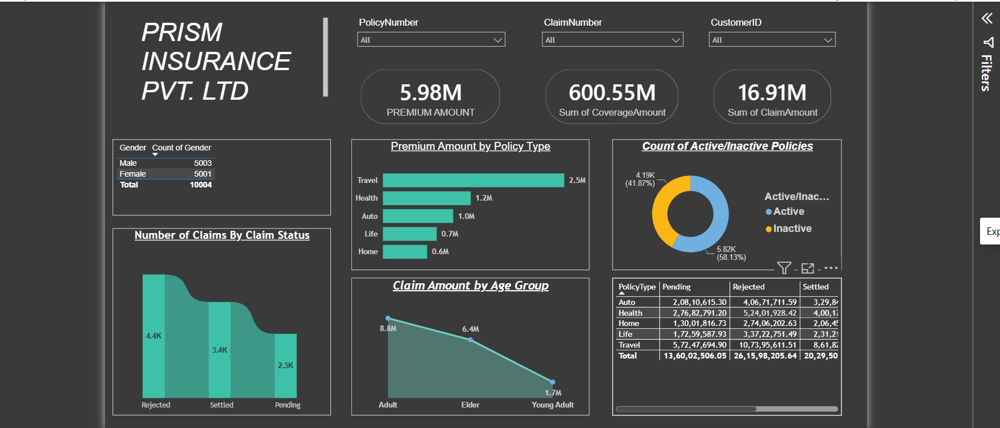

# 🛡️ Insurance Claims & Policy Analytics Dashboard | Power BI

An interactive **Insurance Claims & Policy Analytics Dashboard** developed using **Microsoft Power BI** to analyze insurance policies, premiums, claims, customer demographics, coverage amounts, and policy activity.

## 📊 Dashboard Preview



## 🎯 Project Objective

The objective of this project is to transform insurance policy and claims data into an interactive **Business Intelligence dashboard** that helps users understand policy performance, claim patterns, customer demographics, and premium distribution.

## 🔎 Key Analysis

The dashboard provides insights into:

- 💰 **Premium amount analysis** across different policy types
- 🛡️ **Coverage amount analysis**
- 📋 **Claim status distribution**
- 👥 **Customer demographic analysis**
- 🚻 **Gender-wise customer distribution**
- 📊 **Claim amount by age group**
- 🏷️ **Policy type performance**
- 🔄 **Active vs Inactive policy analysis**
- 🔍 **Customer and policy-level analysis**

## ⚡ Interactive Features

The dashboard includes interactive filters that allow users to analyze insurance data based on:

- Policy Number
- Claim Number
- Customer ID
- Policy Type
- Claim Status
- Customer demographics

These filters dynamically update the dashboard visualizations for focused analysis.

## 📈 Key Dashboard Metrics

| Metric | Value |
|---|---:|
| Total Premium Amount | 5.98M |
| Total Coverage Amount | 600.55M |
| Total Claim Amount | 16.91M |
| Total Customers | 10,004 |

> KPI values are based on the dataset used in this project.

## 📊 Dashboard Visualizations

The dashboard contains:

- 📌 KPI Cards
- 📊 Premium Amount by Policy Type
- 📋 Number of Claims by Claim Status
- 📈 Claim Amount by Age Group
- 🍩 Active vs Inactive Policy Distribution
- 👥 Gender Distribution
- 🔎 Interactive Slicers
- 📑 Policy and Claim Analysis Tables

## 🛠️ Tech Stack

- **Microsoft Power BI**
- **Power Query**
- **DAX**
- **Data Modeling**
- **Data Transformation**
- **Data Visualization**
- **Business Intelligence**
- **Excel / CSV**

## 🔄 Data Analysis Workflow

```text
Raw Insurance Dataset
        ↓
Data Cleaning & Transformation
        ↓
Power Query
        ↓
Data Modeling
        ↓
DAX Calculations
        ↓
Interactive Visualizations
        ↓
Insurance Analytics Dashboard
